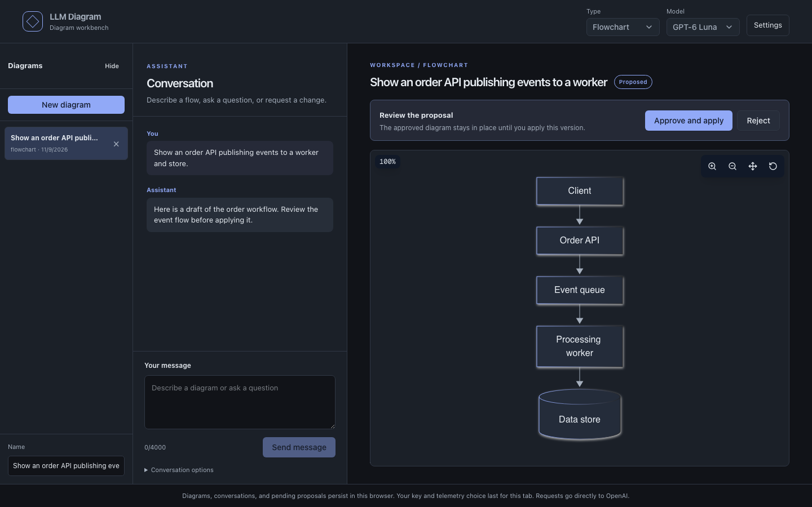
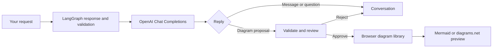

# LLM Diagram

**Turn a conversation into a diagram you can review before you keep it.**

LLM Diagram is a browser-based portfolio sample for drafting Mermaid flowcharts and sequence diagrams or draw.io architecture diagrams with an OpenAI model. The assistant can discuss a request, ask a question, or propose a diagram. You inspect each proposal and explicitly approve it before it replaces the saved version.

[Try the hosted demo](https://llm-diagram.vercel.app/) · [Run locally](#quick-start)



*The workspace shown above uses a mocked OpenAI response. No live model output is represented.*

## Quick start

Requires Node.js 24 and npm.

```bash
npm ci
npm run dev
```

Open <http://localhost:3000>. You can inspect the [sample Mermaid diagram](diagram_examples/Event-Driven%20Architecture%20mermaid.txt) without a key. To use the workspace, choose **Start diagramming**, enter your own OpenAI API key, and describe a diagram. For example:

> Show an order API publishing events to a worker and store.

Review the proposed diagram and its source, then choose **Approve and apply** or **Reject**. Approval does not make another model request. Model access and API charges depend on your OpenAI account.

**Key handling:** The app validates the key with OpenAI, stores it in this tab's `sessionStorage`, and sends requests directly from your browser to OpenAI. Scripts on this site's origin can access the key. This design keeps the sample simple, but is unsuitable for production key handling or sensitive diagrams. See [OpenAI's API key guidance](https://help.openai.com/en/articles/5112595-best-practices-for-api-key).

## What you can do

- **Discuss before drawing.** The assistant can respond with a message, a clarifying question, or a proposal.
- **Control every change.** Preview proposed Mermaid or draw.io code and compare it with the approved diagram before applying it.
- **Keep working across reloads.** Diagrams, conversations, proposals, and approved versions persist in this browser; you can restore a previous version.
- **Export an approved diagram.** Download Mermaid diagrams as SVG when rendered (or Mermaid source as a fallback), and draw.io diagrams as XML.
- **Recover from failures.** Invalid proposals are rejected, and request errors leave your draft and approved diagram available for a manual retry.

## How it works



The Next.js and React UI runs the request and approval flow in the browser. LangGraph routes a single model response through validation; it does not autonomously revise a diagram. Mermaid renders in-page, while draw.io XML uses a diagrams.net iframe. The [architecture notes](docs/architecture.md) describe the request, storage, and external-service boundaries in more detail.

## Configuration and data

No environment variables are required for local use. Optional telemetry uses the values shown in [`.env.example`](.env.example):

| Variable | Purpose |
| --- | --- |
| `NEXT_PUBLIC_POSTHOG_KEY` | PostHog project token, not a personal API key |
| `NEXT_PUBLIC_POSTHOG_HOST` | HTTPS host for that PostHog project |

Set both in `.env.local` to offer a tab-level telemetry opt-in. Without them, telemetry is off. With consent, the app sends outcome, error, model, format, prompt version, duration, and token-count fields, along with PostHog's transport token and anonymous ID. It does not put prompts, chat text, diagram code, or the OpenAI key in custom events. Verify the network payload before enabling a live project.

Diagrams, conversations, pending proposals, and versions use `localStorage`; the API key and telemetry choice use `sessionStorage` for the current tab. **Remove key** clears the tab's key. **Clear conversation** removes the current diagram's chat and proposal. **Clear all local data** removes this app's stored diagrams and settings as well as the key and telemetry choice in the current tab. Browser storage remains accessible to scripts on this origin.

## Development

```bash
npm test                 # Unit and logic tests; mocked OpenAI responses
npx tsc --noEmit         # Type checking
npm run lint             # ESLint
npm run build            # Production build
npx playwright install chromium
npm run test:e2e         # Browser tests against the production build
```

`npm run quality` runs the full sequence above except browser installation. GitHub Actions runs it on pushes to `main` and pull requests. The browser tests use mocked OpenAI responses, so they make no paid API calls. For a limited manual check of live model behavior, see [the prompt check](docs/prompt-check.md); no model-quality result is claimed here.

## Deployment and limits

Vercel can build this as a Next.js project with Node.js 24 and `npm run build`; no server-side OpenAI key is needed. Leave the PostHog variables unset to keep telemetry off. Do not enable `NEXT_PUBLIC_DEBUG_MODE` or `NEXT_PUBLIC_POSTHOG_TEST_MODE` on a public deployment.

This sample has no application API route, database, accounts, or multi-user collaboration. OpenAI receives diagram requests, and draw.io previews load the diagrams.net embed. Validation checks syntax and known unsafe constructs, but does not establish a diagram's accuracy or guarantee safe rendering in every browser. Live model behavior and cost have not been evaluated.

## Contributing

For bugs, open an issue with reproduction steps and the relevant diagram format. For changes, include a focused pull request and run `npm run quality` where practical. Never include API keys, private prompts, or sensitive diagrams in an issue or test fixture.

## License

Original project code is [MIT licensed](LICENSE). Dependencies, icons, and fonts keep their own licenses; the bundled Geist fonts use the [SIL Open Font License](src/app/fonts/OFL.txt). The diagrams.net embed is a separate service.
